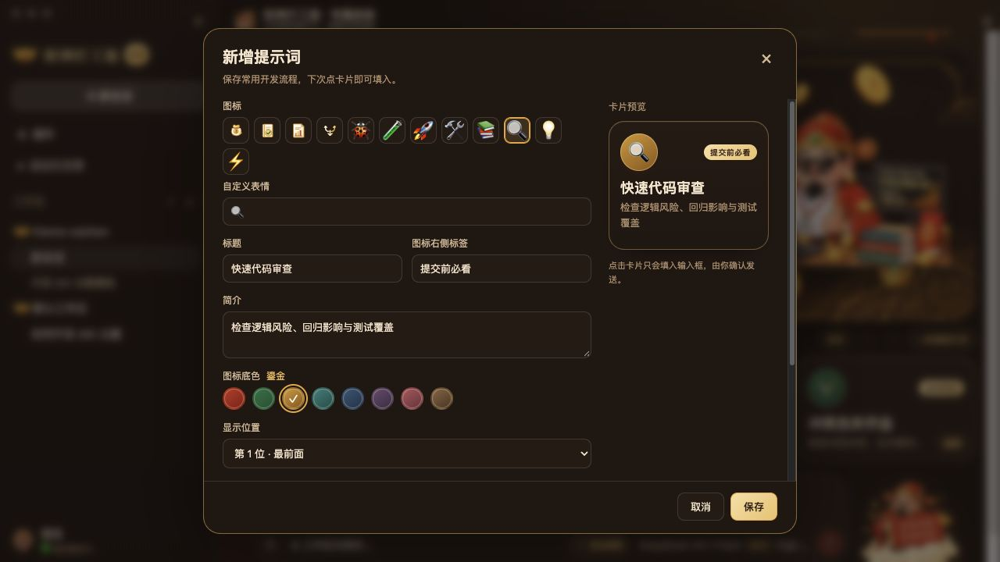
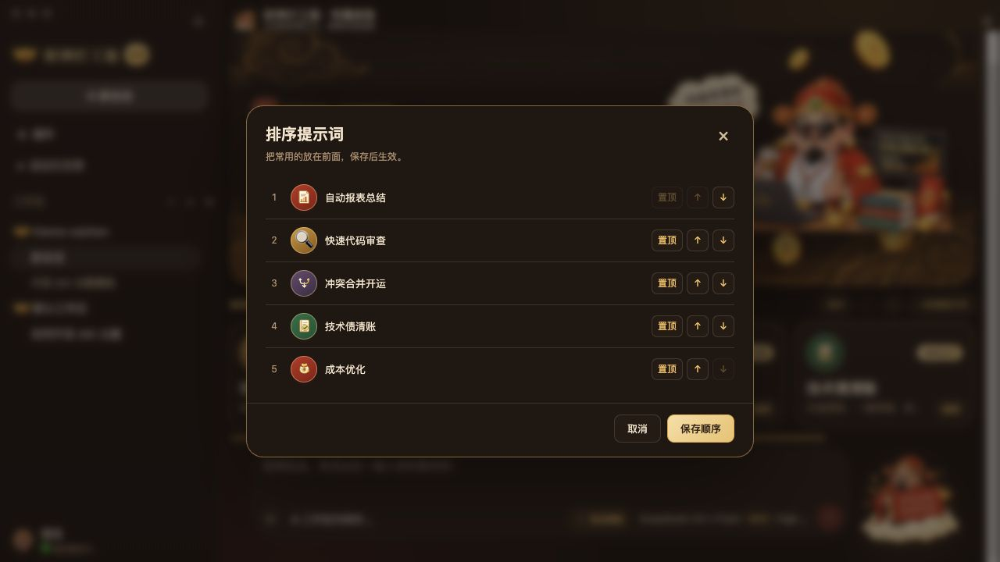

# 财神打工版 · dsh-theme-caishen

为 [DeepSeek Harness（DSH）](https://github.com/deepseek-ai/deepseek-harness) 制作的第三方 Web 界面主题：暖纸与深檀双配色、朱红描金、财神插画，以及可以自己管理的常用提示词。

> 代码写得好，KPI 少不了。

## 效果预览

| 深色 | 浅色 |
| --- | --- |
|  |  |

首页图展示整体配色与插画；下方编辑和排序图展示当前提示词管理功能。文档截图来自使用插件组件、样式与宿主 CSS 的独立预览，实际效果随 DSH 版本、窗口大小和字体设置变化。

## 功能

- 浅色、深色及跟随系统配色，保留 DSH 的字体与字号设置。
- 财神首页、金元宝品牌与工作区图标、输入框旁的祥云财神。
- 「今日财运在线」与「功德 +1」彩蛋，点击后 `+1` 从文字位置向上飘。
- 常用提示词库：新增、编辑、删除、排序，支持左右箭头与横向滚动。
- 卡片可设置图标或 emoji、八种主题底色、标签、标题、简介、提示词正文及显示位置。
- 界面文案支持中英文；插画中的文字为中文。



## 安装

当前清单限定 DSH `0.2.1-rc.2`，需要能在侧栏打开「插件」管理页面。本主题面向 DSH 的 Web 界面，包括使用该界面的桌面端，不改变终端界面。

### 在 DSH 中安装

1. 打开侧栏「插件」→「添加插件」。
2. 填写以下地址，点击「安装」：

   ```text
   git+https://github.com/MrGuang123/dsh-theme-caishen.git#v0.1.1
   ```

3. 安装完成后点击「立即启用」。如 DSH 提示需要重启，按提示操作。

推荐使用带版本标签的地址，便于复现问题和回退；直接使用仓库地址会跟随默认分支的内容。

### 使用命令行安装

使用 DSH 的插件命令，安装到你准备使用的 profile：

```bash
dsh plugin --profile web add 'git+https://github.com/MrGuang123/dsh-theme-caishen.git#v0.1.1'
```

将 `web` 换成实际使用的 CLI profile 名称；桌面端用户建议直接从「插件」页面安装。随后按命令提示完成操作，并在 DSH「插件」页面确认本主题已启用。无需自行运行 `pnpm add` 或手工修改 profile 文件。

安装方式以 [DSH 官方插件管理说明](https://github.com/deepseek-ai/deepseek-harness/blob/master/packages/client/ui-plugin-manager/README.zh.md) 为准。GitHub 无法访问时，切换 npm 镜像不能代替 GitHub 下载；也可以下载仓库到本机，再在「添加插件」中填写解压后的插件目录绝对路径。

## 使用提示词库

新会话首页默认提供成本优化、技术债清账、自动报表总结、冲突合并开运四张卡片。点击卡片只会将提示词填入输入框，**不会自动发送**；可以继续修改后再发送。

- 「新增提示词」打开编辑弹窗，新卡片默认排在最前面。
- 卡片上的「编辑」可修改全部字段、显示位置或删除卡片；删除需要再次确认。
- 「排序」可将卡片置顶、上移或下移，点击「保存顺序」后才生效。
- 图标可选预设图案或单个 emoji；底色提供朱红、翠绿、鎏金、青玉、黛蓝、紫檀、胭脂、沉香。



自定义卡片、顺序与功德计数保存在当前 Web 界面来源的浏览器本地存储（`localStorage`），不会由本插件上传或云同步。不同浏览器、设备或访问地址可能使用不同的数据；清理网站数据会删除它们。升级或切换环境前，请自行备份需要保留的提示词文本。

## 更新、停用和卸载

- **更新**：查看新版本说明，在「插件」页面卸载旧包，再用发布说明中的新标签地址重新安装。主题不提供自动更新。
- **暂时停用**：关闭整个「财神打工版」组合包，按 DSH 提示刷新或重启，恢复内置界面。请不要只关闭其中的 `theme-caishen` 组件行，否则组合包中关闭官方品牌的补丁仍会生效。
- **卸载**：在「插件」页面移除 `dsh-theme-caishen`。插件不主动清理浏览器中的自定义卡片与功德计数。

## 跟随系统时为什么白天也可能显示深色

「跟随系统」由 DSH 读取系统当前的实际外观，不按白天或夜晚直接判断。本主题仅提供浅色与深色配色，不修改系统外观或 DSH 的外观设置。

macOS 27 的「自动」外观会参考夜览（Night Shift）日程；未设置日程时参考日出日落，并且至少空闲一分钟才切换。系统当前仍处于深色时，DSH 和本主题随之显示深色属于正常表现。详见 [Apple 外观设置说明](https://support.apple.com/en-ie/guide/mac-help/mchlp1225/27/mac/27)。

如希望 DSH 始终显示浅色，可在 DSH「设置 → 外观」选择「浅色」。验证系统同步时，可暂时将 macOS「系统设置 → 外观」改为「浅色」，同时让 DSH 保持「跟随系统」；界面应随之变浅。若系统已经明确切为浅色而 DSH 仍深色，请在 Issues 中附上系统与 DSH 的外观状态及版本，继续定位宿主同步问题。

## 兼容性与数据

- 这是独立第三方主题，不是 DeepSeek 官方主题。建议避免同时启用多个会覆盖品牌、颜色或相同界面插槽的主题。
- 配色与适配目标为 DSH `0.2.1-rc.2`，`engines.dsh` 限定该版本；其他版本可能被插件管理器拒绝安装，需验证后再扩大范围。发布前验收方法见 [发布说明](docs/RELEASING.md)。
- 部分装饰样式依赖 DSH 的界面结构，DSH 升级后可能需要调整。遇到布局异常时可先停用主题，再在 [Issues](https://github.com/MrGuang123/dsh-theme-caishen/issues) 提供 DSH 版本、操作系统、深浅色和窗口大小。
- 插件运行时从自身目录提供图片资源，不引入额外远程图片或统计服务。宿主侧注册两组只读素材路由；提示词只在你点击卡片时写入宿主输入框。
- 插画中的金额、效率、财运和功德均为装饰彩蛋，不读取实际项目成本或财务数据。

开发说明见 [开发文档](docs/DEVELOPMENT.md)，素材来源见 [素材说明](docs/ARTWORK.md)，发布步骤见 [发布文档](docs/RELEASING.md)。

## 许可

[MIT](LICENSE) · MrGuang123
